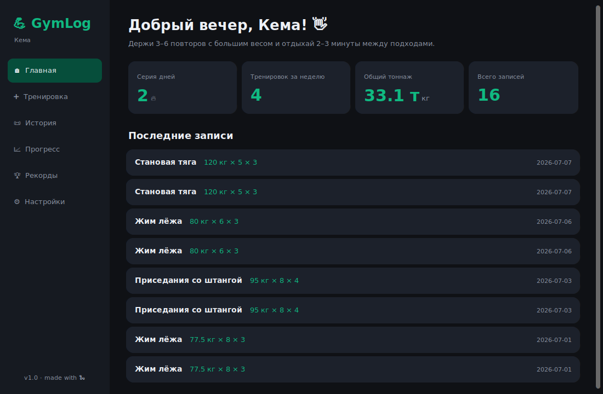
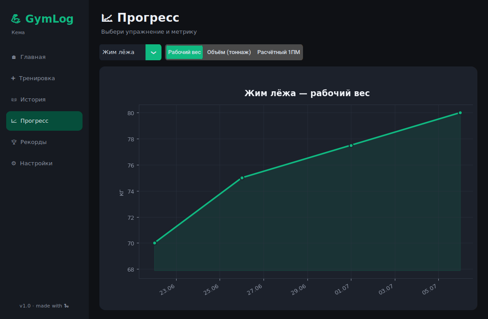
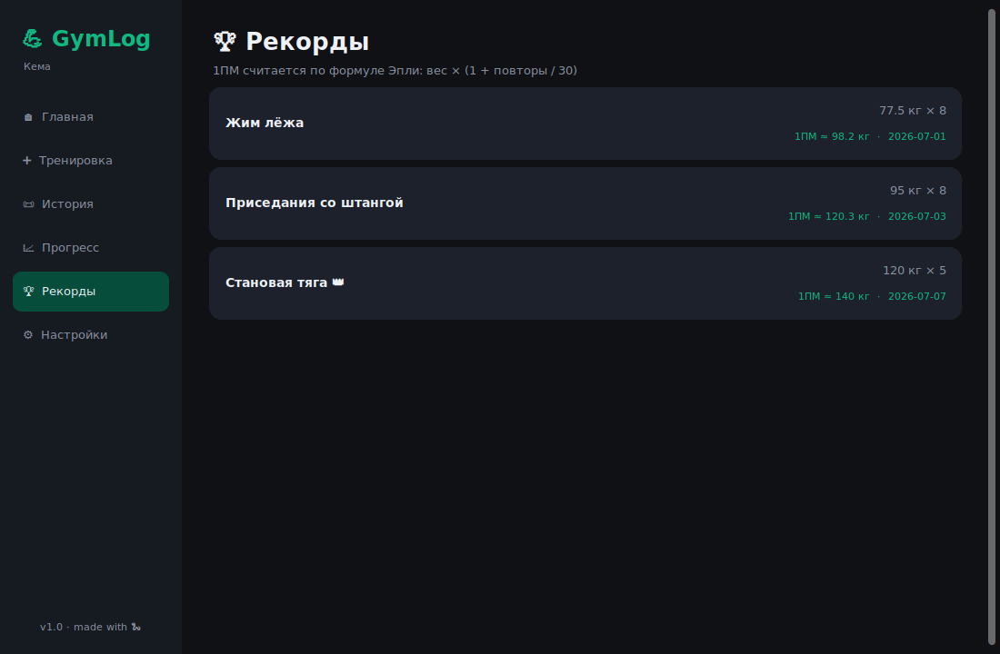

# 💪 GymLog — трекер тренировок

Десктопное приложение для отслеживания прогресса в зале. Записывай подходы, следи за рекордами и смотри рост рабочих весов на графиках.


## Скриншоты

| Дашборд | Прогресс | Рекорды |
|---|---|---|
|  |  |  |

## Возможности

- **Дневник тренировок** — упражнение, вес, повторы, подходы, RPE и заметки
- **Библиотека упражнений** — 40+ упражнений по группам мышц + свои
- **Дашборд** — серия дней 🔥, тоннаж, тренировки за неделю, советы под твою цель
- **Графики прогресса** — рабочий вес, объём и расчётный 1ПМ по каждому упражнению
- **Личные рекорды** — лучший подход и 1ПМ по формуле Эпли
- **Трекинг веса тела** с графиком
- **Персонализация** — тёмная/светлая тема, 5 акцентных цветов, кг/lb, профиль с целью
- **История с фильтрами** — по упражнению и периоду, удаление записей
- **Экспорт в CSV** — открывается в Excel

## Установка и запуск

```bash
git clone https://github.com/kemranbatcaev02-gif/gymlog.git
cd gymlog
pip install -r requirements.txt
python main.py
```

При первом запуске приложение попросит имя, вес и цель — под неё подстраиваются советы на дашборде.

## Структура проекта

```
gymlog/
├── main.py                  # точка входа: окно, сайдбар, роутинг
├── app/
│   ├── config.py            # настройки и профиль (JSON)
│   ├── database.py          # SQLite: тренировки, рекорды, статистика
│   └── ui/
│       ├── theme.py         # палитры тёмной/светлой темы
│       ├── widgets.py       # переиспользуемые карточки
│       ├── onboarding.py    # первый запуск
│       ├── dashboard.py     # главная со статистикой
│       ├── workout_page.py  # добавление тренировки
│       ├── history_page.py  # история с фильтрами
│       ├── charts_page.py   # графики (matplotlib)
│       ├── records_page.py  # личные рекорды
│       └── settings_page.py # настройки
└── data/
    └── exercises.json       # библиотека упражнений
```

## Технологии

- **[CustomTkinter](https://github.com/TomSchimansky/CustomTkinter)** — современный UI поверх tkinter
- **SQLite** — локальная база, никаких серверов
- **Matplotlib** — графики, встроенные прямо в окно приложения

## Как считается 1ПМ

Одноповторный максимум оценивается по формуле Эпли:

```
1ПМ = вес × (1 + повторы / 30)
```

## Лицензия

MIT — делай что хочешь, ссылка на автора приветствуется :)
